# penpath

Free software that takes you from an image to a finished pen plot: simple by default, customizable when needed. Use it as a Python library, from the command line, or through AI agents.

[](https://pypi.org/project/penpath/)
[](LICENSE)
[](https://github.com/sermelo/penpath/actions)

---

## Quickstart

```bash
# Install
pip install penpath

# Convert a photo to SVG (uses default settings)
penpath convert photo.jpg
# → photo_plot.svg

# View the result in a browser or send to your plotter
```

That's it! You now have a plottable SVG optimized for pen plotting.

---

## Installation

### From PyPI (recommended)

```bash
pip install "penpath[vpype]"
```

The `vpype` extra is optional: `pip install penpath` installs the core with no
vpype dependency.

### From source (development)

```bash
git clone https://github.com/sermelo/penpath.git
cd penpath
uv sync --extra dev  # or: pip install -e ".[dev]"
```

Run the whole nightly workload locally — dependency sync, a timed reference
photo conversion and the full unit + integration suite, including the slow
quality gates — with:

```bash
bash scripts/nightly.sh
```

See [docs/TESTING.md](docs/TESTING.md#run-the-nightly-workload-locally) for the
prerequisites and the exact steps it runs.

### Optional: `vpype`

For best results (line merging, sorting, optimization), install the `vpype`
extra, which pulls in [vpype](https://vpype.readthedocs.io/):

```bash
pip install "penpath[vpype]"
```

Installing vpype directly with `pip install vpype` works too; the `test` extra
also pulls it in. Without vpype, penpath prints
`vpype not found, falling back to direct SVG export (install it with: pip install "penpath[vpype]")`.
Penpath's own simplify → merge → sort still runs, but vpype's extra
`linemerge → linesimplify → reloop → linesort` pass does not, so the output is
less optimized. Use `--no-vpype` to skip vpype on purpose. Either way penpath
writes the final SVG: vpype contributes geometry only.

---

## Core Concepts

| Concept | Description |
|---------|-------------|
| **PFM** (Pen Follower Module) | Algorithm that converts pixels to lines. Built in: `sketch_lines` (hatching), `sketch_squares` (grid hatching), both ported from DrawingBotV3, `contour` (scikit-image + Shapely outlines), `stipple` (weighted Poisson-disk dots), `spiral_sawtooth` (continuous-line sawtooth spiral, ported from DrawingBotV3), `hatch` (straight and cross-hatched millimetre-spaced lines), `patch_hatch` (hand-drawn style cross-hatching in small patches), `tsp` (the whole picture as one continuous line) `squiggle` (rows of waves that grow with darkness) and `engraving` (lines that swell where the image is darker). Run `penpath info pfms` for the full list. |
| **Palette** | An ordered set of pens. Each pixel is drawn by its nearest palette colour; each used pen becomes one SVG layer. |
| **Filters** | Image preprocessing: grayscale, threshold, blur, contrast, etc. Applied in order before PFM. |
| **Geometry optimization** | Simplify (RDP), merge (collinear join), sort (greedy NN + 2-opt) — runs automatically. |
| **vpype** | External CLI for final SVG optimization (linemerge, linesimplify, reloop, linesort). |
| **Project file** | YAML file capturing all settings for reproducible, iterative workflows. |

---

## Commands Overview

| Command | Purpose |
|---------|---------|
| `penpath convert` | Photo → SVG (main command) |
| `penpath preview` | Simulate an SVG or G-code file and save a preview image |
| `penpath compare` | Draw every PFM and preset on one labelled contact sheet |
| `penpath evaluate` | Score an SVG's likeness to the original image and its machine cost |
| `penpath gcode` | Turn a reviewed SVG into machine G-code with a machine profile |
| `penpath info` | List presets and machine profiles, show image details, inspect config |
| `penpath config` | Manage user configuration (~/.config/penpath/config.toml) |

See [docs/CLI.md](docs/CLI.md) for complete reference.

---

## Basic Usage

```bash
# Simple conversion with defaults
penpath convert input.jpg

# Custom output path (positional argument or -o/--output; give only one)
penpath convert input.jpg output.svg
penpath convert input.jpg -o output.svg

# Apply image filters before drawing
penpath convert photo.jpg -f grayscale -f "posterize:levels=4,dither=floyd_steinberg"

# Tonal range is normalized automatically; images already spanning at least
# 7/8 of 0-255 are left alone. Keep the original tones with:
penpath convert photo.jpg --no-auto-equalize

# Spread a dark or flat photo evenly over the algorithm's own tone steps
penpath convert photo.jpg --pfm hatch:crosshatch --equalize-levels

# Palette mode masks pale paper as no ink by default; tune or override it:
penpath convert photo.jpg --palette stabilo_88 --background-threshold 6
penpath convert photo.jpg --palette stabilo_88 --no-background
penpath convert photo.jpg --pen fine --background

# The default local paper field follows lighting gradients and shadows; the
# global method uses one detected colour (with a lower cut-off it leaves a pale
# gradient as ink, which is the regression the local field fixes):
penpath convert photo.jpg --palette stabilo_88 --background-method local
penpath convert photo.jpg --palette stabilo_88 --background-method global --background-threshold 5

# Muted colour photos can be boosted before the palette split (1.0 is off):
penpath convert photo.jpg --palette stabilo_88 --palette-adapt
penpath convert photo.jpg --palette stabilo_88 --saturation 2.0

# Saved looks: sketch (the default), directional hatch, or clean outlines
penpath convert photo.jpg --style sketch -o sketch.svg
penpath convert photo.jpg --style hatch -o hatch.svg
penpath convert photo.jpg --style outline -o outline.svg

# Adjust PFM (Sketch Lines) settings; -s wins over a look's value
penpath convert photo.jpg -s line_density=0.5 -s max_fill=90 -s seed=42

# Near-white source pixels stay blank paper; 1.0 opts out of the white pen lift
penpath convert photo.jpg -s white_threshold=0.9 -o white-lift.svg
penpath convert photo.jpg --pfm sketch_squares -s white_threshold=0.9 -o squares-white.svg

# Keep at least 15% of the darkest source tones uninked (1.0 opts out)
penpath convert photo.jpg -s max_tone_ink=0.85 -o hatched-dark.svg

# Grid hatching bends short strokes into a structured, graphic page; presets set the look
penpath convert photo.jpg --pfm sketch_squares -s seed=42
penpath convert photo.jpg --pfm sketch_squares:crosshatch-grid -s seed=42

# Spiral Sawtooth draws one continuous line; rings are round by default (shape=circle)
penpath convert photo.jpg --pfm spiral_sawtooth:fine -s ring_spacing=4 -o spiral.svg
# cover grows the round rings into all four corners; ellipse keeps the old stretched look
penpath convert photo.jpg --pfm spiral_sawtooth -s shape=cover -o spiral-cover.svg
penpath convert photo.jpg --pfm spiral_sawtooth -s shape=ellipse -o spiral-ellipse.svg

# Hatch lays down straight, millimetre-spaced lines (not --style hatch)
penpath convert photo.jpg --pfm hatch:crosshatch -o hatch.svg
# Fit the tone bands to a flat photo's own range
penpath convert photo.jpg --pfm hatch:crosshatch -s auto_thresholds=true -o fitted.svg

# Patch Hatch: hand-drawn cross-hatching in small patches that follow the edges
penpath convert photo.jpg --pfm patch_hatch -s seed=42 -o patch_hatch.svg

# TSP art: one continuous line through darkness-weighted dots (one pen lift)
penpath convert photo.jpg --pfm tsp -s seed=42 -o tsp.svg

# Squiggle: one wavy line per row, taller and tighter waves in dark areas
penpath convert photo.jpg --pfm squiggle -o squiggle.svg
# Engraving: parallel lines that get thicker in dark areas (straight, swirl or contour)
penpath convert photo.jpg --pfm engraving -o engraving.svg

# Opt into the full tonal range (solid black areas included)
penpath convert photo.jpg -s max_fill=100 -o full-range.svg

# Choose pen and paper
penpath convert photo.jpg --pen fine --paper a4

# Paper fit: contain (the default), cover and crop, or use the --dpi pixel size
penpath convert photo.jpg -o fit.svg --paper 190x190 --fit fit
penpath convert photo.jpg -o fill.svg --paper 190x190 --fit fill
penpath convert photo.jpg -o none.svg --paper 190x190 --fit none --dpi 300

# Override margins for one run: one value or top,right,bottom,left
penpath convert photo.jpg -o margin.svg --paper 190x190 --margin 5
penpath convert photo.jpg -o sides.svg --paper 190x190 --margin 20,5,20,5

# Skip vpype (faster, less optimized)
penpath convert photo.jpg --no-vpype

# Preview the simulated plot as an image
penpath preview plot.svg -o preview.png --px-per-mm 10
# Also show pen-up travel as thin light lines (default stays ink-only)
penpath preview plot.svg -o travel_preview.png --travel

# Evaluate whole-page and ink-only SSIM, machine cost and ink coverage
penpath evaluate photo.jpg plot.svg
penpath evaluate photo.jpg plot.svg --json | jq '{likeness, masked_likeness}'

# Turn the reviewed SVG into G-code for a machine profile (stdout stays empty)
penpath gcode plot.svg --profile generic -o plot.gcode
penpath gcode plot.svg --profile generic --dry-run > plot.gcode
# A multi-pen SVG becomes one G-code layer per used pen, in layer order, with
# one pen-change block before each layer that follows the first
penpath convert photo.jpg -o palette_plot.svg --palette stabilo_88 -s seed=42
penpath gcode palette_plot.svg --profile generic -o palette_plot.gcode
# The built-in aquila profile drives sergio's Voxelab Aquila: it parks the page
# against the usable corner, ramps each landing and pauses to set every pen.
# Its 10 mm safety margin leaves about 177 x 171 mm of usable area, so lay the
# card out on a 170x170 mm page:
penpath convert photo.jpg -o card.svg --paper 170x170 -s seed=42
penpath gcode card.svg --profile aquila -o card.gcode
# A page slightly past the usable area is fitted by default, with a warning on
# stderr; add --no-fit to keep the strict error instead
penpath gcode card.svg --profile aquila
# Place the page at a named spot or an exact pen-space lower-left corner; with
# neither, the profile decides (Aquila: front-right, generic/ramped: origin)
penpath gcode card.svg --profile aquila --place center -o centred.gcode
penpath gcode card.svg --profile aquila --at 20,20 -o corner.gcode
# Plot a frame around the page first, then pause to check the paper position
penpath gcode card.svg --profile aquila --place center --frame --frame-pause -o framed.gcode
penpath preview framed.gcode -o framed.png

# Check the G-code without a machine: the PNG shows the bed, the page and the
# same ink as the SVG preview
penpath preview plot.gcode -o gcode_preview.png
```

`preview` and `evaluate` take either `--px-per-mm` (pixels per millimetre) or
`--dpi` (real dots per inch, divided by 25.4); the two flags are mutually
exclusive. `preview` defaults to 4 px/mm (about 101 DPI) and `evaluate` to 96
DPI (96/25.4 px/mm). A render above 40 MP is refused before any image is
allocated with `Render too large: ... above the 40 MP limit`; pass `--force`
to override that guard only (invalid values are still rejected). The flag on
`penpath convert --dpi` is different: it sets the drawn image size with
`--fit none`.

### Working resolution

Large photos are downscaled before drawing, so they take tens of seconds rather
than hours: a 12 MP photo on 190x190 mm paper with a 0.4 mm pen converted in
11.49 s on our VPS, and the reference `photo.jpg` with the default A4/0.3 mm
settings took 56 s. These are measured times; see `docs/TESTING.md` for the
commands and machine. Penpath uses one pixel per pen width on the longest
side of the paper (`paper_longest_side_mm / pen_width_mm`, clamped to
256–1024 px) and never enlarges the source. Pixel-valued Sketch Lines settings
(`min_length`, `max_length`, `sample_step`) are interpreted in working-image
pixels and are
not scaled. The chosen size is printed on stderr and recorded in the SVG
metadata; the image rectangle on the page is unchanged. Override it with
`--max-resolution` or keep all source pixels with `--no-downscale`:

```bash
penpath convert photo.jpg --paper 190x190 --pen 0.4
# Working resolution: 475x358 px (source 4080x3072 px, scale 0.116)

penpath convert photo.jpg --max-resolution 800
penpath convert photo.jpg --no-downscale
penpath info image photo.jpg  # shows the resolution penpath would plan
```

Because the resolution comes from the paper, a smaller page **recomposes** the
image rather than shrinking an existing drawing: the same 0.4 mm pen cannot fit
the larger stroke set on less paper. To reproduce a reviewed drawing at a
smaller size, pin the working resolution with `--max-resolution`; with the same
settings the strokes are identical and only the page scale changes:

```bash
penpath convert photo.jpg -o large.svg --paper 190x107,0 --pen "0.4,#000000,fineliner" -s seed=42
penpath convert photo.jpg -o small.svg --paper 130x73,0 --pen "0.4,#000000,fineliner" -s seed=42 --max-resolution 475
```

### Progress and quiet mode

`convert` keeps stdout empty and reports progress on stderr. On a terminal it
shows a live bar; redirected to a log it writes one flushed line per stage, so
the log fills in while the command runs:

```bash
penpath convert photo.jpg 2>convert.log
# [1/6] Loading image... done in 0.1 s
# [2/6] Downscaling image... done in 1.4 s
# ...
# [6/6] Exporting SVG... done in 0.1 s
# Done in 20.9 s
# ✓ SVG saved to: photo_plot.svg

penpath convert photo.jpg --quiet  # no stderr output; errors still shown
```

---

## Project Files: Reproducible Workflows

Save your entire pipeline in a YAML file for version control and iteration.

```bash
# Create a project file manually (see minimal example below)
# Edit my_project.yaml to taste
penpath convert photo.jpg --project my_project.yaml
```

**Example `project.yaml`:**

```yaml
# penpath project file v1
version: 1

input:
  path: "photo.jpg"
  auto_orient: true

filters:
  - grayscale:
      method: luminance
  - posterize:
      levels: 4
      dither: floyd_steinberg
  - gaussian_blur:
      radius: 1.0

pfm:
  name: sketch_lines
  settings:
    line_density: 0.3
    max_fill: 80.0
    min_length: 2.0
    max_length: 40.0
    angle_range: [0.0, 360.0]
    shading_enabled: true
    squiggle_enabled: false
    erase_enabled: false
    seed: null

pen:
  name: fine
  # or inline:
  # width_mm: 0.3
  # color: "#000000"
  # pen_type: fineliner

paper:
  name: a4
  # or inline:
  # width_mm: 210
  # height_mm: 297
  # margin_mm: 10
  # or four per-side margins in [top, right, bottom, left] order:
  # margin_mm: [10, 20, 10, 20]
  # fit: fit   # fit, fill or none (default fit)
  # background_color: "#FFFFFF"

output:
  path: "plot.svg"
  vpype: true
```

**Minimal example:**

```yaml
version: 1
input:
  path: "photo.jpg"
output:
  path: "plot.svg"
```

---

## Common Workflows

### Quick Art Print

```bash
penpath convert photo.jpg -o art.svg \
  -f grayscale -f "posterize:levels=6,dither=floyd_steinberg" \
  -s line_density=0.4 -s shading_enabled=true -s seed=12345 \
  --pen "0.4,#000000,fineliner" --paper a4
```

### Project-Based Iteration

```bash
# Create project file manually from the minimal example
# Edit portrait.yaml: tweak filters, PFM settings, pen, paper
penpath convert photo.jpg --project portrait.yaml
# Re-run after edits — same results every time
```

### Batch Processing (Shell)

```bash
for img in photos/*.jpg; do
  penpath convert "$img" -o "output/$(basename "$img" .jpg).svg" --project batch.yaml
done
```

### Debug Pipeline Stages

```bash
# Inspect image properties
penpath info image photo.jpg

# See filter effects without vpype optimization
penpath convert photo.jpg -f grayscale -f threshold --no-vpype -o debug.svg
# Open debug.svg in browser/Inkscape to inspect lines
```

### Check the Plot Before Printing

```bash
penpath convert photo.jpg -o plot.svg
# Render a preview at 10 px/mm on cream paper
penpath preview plot.svg -o preview.png --px-per-mm 10 --paper-color "#FFFDD0"
# Check likeness against the original (whole-page, ink-only and edge SSIM + machine cost)
penpath evaluate photo.jpg plot.svg
# Machine-readable output for scripts and agents
penpath evaluate photo.jpg plot.svg --json | jq '{likeness, masked_likeness, total: .machine_cost.total}'
```

The machine-cost table includes a `Pen` column with the Inkscape layer name
(falling back to the stroke hex) and a `Coverage (%)` column; the JSON output
includes `pen` and `ink_coverage_pct` per layer, and `ink_coverage_pct` in
`total`. A layer covering more than 50% of the page warns on stderr (naming
the layer and suggesting
`--background-threshold` / `--saturation`); `--coverage-warn 0` silences it.
Warnings never change the exit code or the JSON on stdout.

`SSIM (ink only)` (`masked_likeness` in JSON) averages SSIM over the source
image's ink pixels, using the paper colour detected from that source. It stays
low for a near-blank plot on a mostly-white page where whole-page SSIM stays
high; ink the plot adds outside the source mask is reported by coverage instead.

## Examples

Every image below comes from a committed, free-licence fixture and can be
rebuilt with [`examples/gallery/generate.sh`](examples/gallery/generate.sh).
Each algorithm row reads **original → simulated SVG plot → simulated G-code**:
the plot is `penpath preview` of the SVG and the G-code view is `penpath preview`
of the output of `penpath gcode --profile generic`. The G-code preview draws a
thin bed/page outline around the same ink. All examples use A4 paper,
`-s seed=42` and a smaller working resolution (`--max-resolution 800`) to keep
the run short. The algorithm rows use the default 0.3 mm black `fine` pen; the
pen-width, colour and palette examples change the pen deliberately. Previews
are 601×849 px (`--px-per-mm 2.86`) except the three pen-width plots and the bold
G-code preview, which use `--px-per-mm 3.2` (672×950 px) so the wider strokes stay
distinguishable and the bold ink looks solid, all well under 200 KB. Run the
script from a checkout with `penpath` on your PATH to regenerate the whole gallery.

### Worked Example: Photo → SVG → Preview

The shipped defaults are calibrated against five reference images. Here is the
whole path on one of them, from a repository checkout:

```bash
# Convert with the shipped defaults; the seed makes the result reproducible
penpath convert tests/fixtures/images/reference/photo.jpg -o photo_plot.svg -s seed=42

# Render the simulated plot as an image
penpath preview photo_plot.svg -o photo_preview.png --px-per-mm 10

# Score likeness (whole-page SSIM 0.5099 with these defaults), ink-only SSIM and machine cost
penpath evaluate tests/fixtures/images/reference/photo.jpg photo_plot.svg
```

This is what the simulated plot looks like; the 600 px greyscale preview is
committed at [docs/images/luc-47/photo_after.png](docs/images/luc-47/photo_after.png):

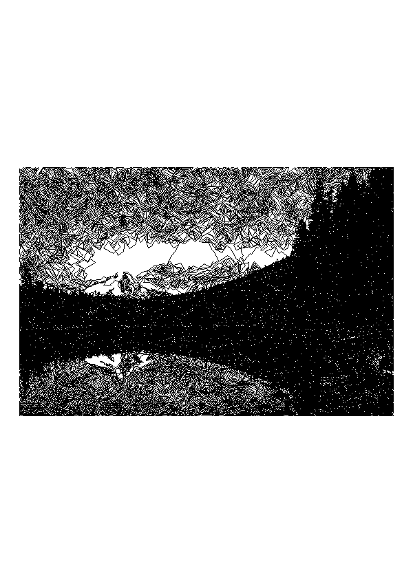

Before the LUC-53 algorithm fix the same photo produced a much smaller, sparser
plot (SSIM 0.4917, only 41% of the placement width covered). Compare the
[before preview](docs/images/luc-47/photo_before.png) and the full
[before/after measurements](docs/TESTING.md#final-shipped-defaults-measurement-luc-54-2026-11-25).

### One example per algorithm

All nine use the free [Santa portrait](tests/fixtures/images/reference/santa.jpg)
as the source. Presets were picked after opening the rendered previews: the
hatching and contour read as a face, stipple keeps the beard as paper, and
`spiral_sawtooth:fine` is the cleanest of that PFM's three presets (an abstract
continuous-line reading rather than a portrait). Spiral rings are round by
default (`shape=circle`); `shape=cover` fills a landscape photo's corners and
`shape=ellipse` keeps the old stretched look.

#### `sketch_lines` (the default)

| Original | Simulated SVG plot | Simulated G-code |
|:--------:|:------------------:|:----------------:|
| 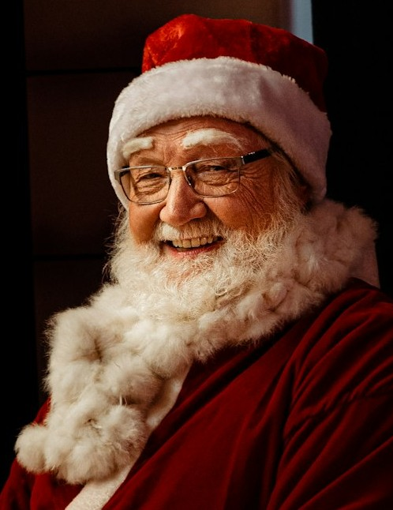 | 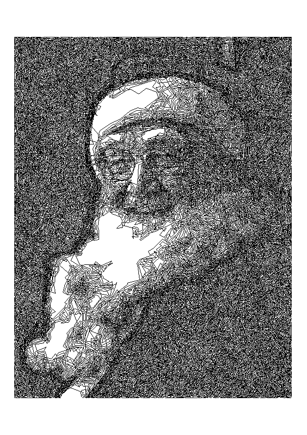 |  |
| Santa's red hat, white beard and glasses on a dark background. | Dense free-angle hatching: hat and coat read dark, beard stays mostly paper. | The same strokes inside the A4 page outline from the generic profile. |

```bash
penpath convert tests/fixtures/images/reference/santa.jpg -o build/gallery/sketch_lines.svg --paper a4 --max-resolution 800 -s seed=42 -q --pfm sketch_lines
penpath preview build/gallery/sketch_lines.svg -o docs/images/luc-88/sketch_lines_plot.png --px-per-mm 2.86
penpath gcode build/gallery/sketch_lines.svg --profile generic -o build/gallery/sketch_lines.gcode
penpath preview build/gallery/sketch_lines.gcode -o docs/images/luc-88/sketch_lines_gcode.png --px-per-mm 2.86
```

#### `sketch_squares:fine`

| Original | Simulated SVG plot | Simulated G-code |
|:--------:|:------------------:|:----------------:|
|  | 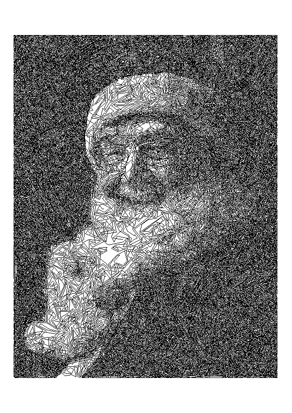 | 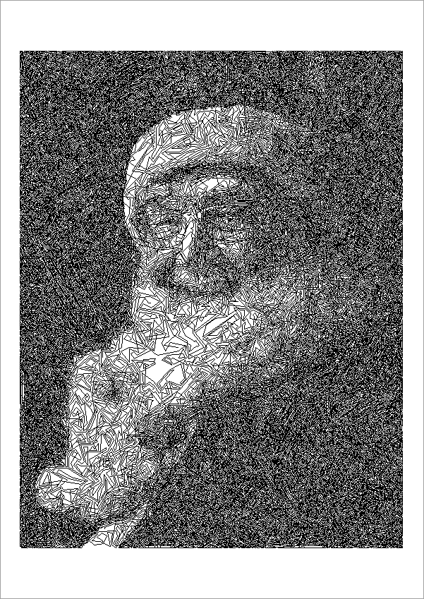 |
| Santa's red hat, white beard and glasses on a dark background. | Short grid-aligned strokes bend around the face; dark hat and coat, open beard. | The grid strokes placed on the A4 page, with travel hidden. |

```bash
penpath convert tests/fixtures/images/reference/santa.jpg -o build/gallery/sketch_squares.svg --paper a4 --max-resolution 800 -s seed=42 -q --pfm sketch_squares:fine
penpath preview build/gallery/sketch_squares.svg -o docs/images/luc-88/sketch_squares_plot.png --px-per-mm 2.86
penpath gcode build/gallery/sketch_squares.svg --profile generic -o build/gallery/sketch_squares.gcode
penpath preview build/gallery/sketch_squares.gcode -o docs/images/luc-88/sketch_squares_gcode.png --px-per-mm 2.86
```

#### `contour_portrait`

| Original | Simulated SVG plot | Simulated G-code |
|:--------:|:------------------:|:----------------:|
|  |  | 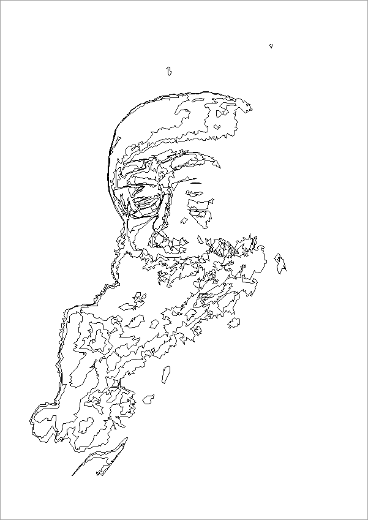 |
| Santa's red hat, white beard and glasses on a dark background. | Clean four-level outlines: hat brim, glasses, nose and coat edges on open paper. | The outlines inside the page outline, drawn with pen-up travel hidden. |

```bash
penpath convert tests/fixtures/images/reference/santa.jpg -o build/gallery/contour.svg --paper a4 --max-resolution 800 -s seed=42 -q --pfm contour_portrait
penpath preview build/gallery/contour.svg -o docs/images/luc-88/contour_plot.png --px-per-mm 2.86
penpath gcode build/gallery/contour.svg --profile generic -o build/gallery/contour.gcode
penpath preview build/gallery/contour.gcode -o docs/images/luc-88/contour_gcode.png --px-per-mm 2.86
```

#### `stipple_default`

| Original | Simulated SVG plot | Simulated G-code |
|:--------:|:------------------:|:----------------:|
|  | 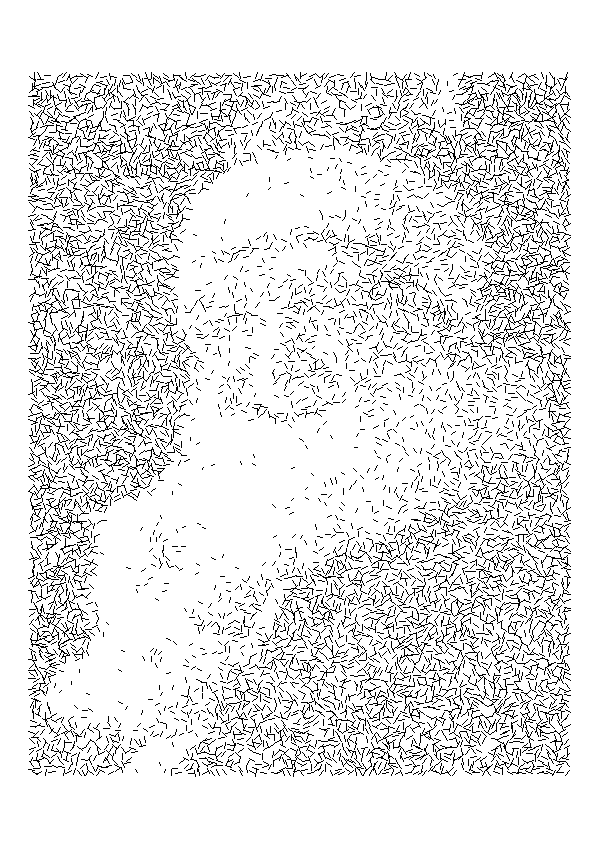 |  |
| Santa's red hat, white beard and glasses on a dark background. | Short dashes cluster in hat, background and coat; the beard stays clear paper. | The same stipple marks placed on the page, with pen-up travel hidden. |

```bash
penpath convert tests/fixtures/images/reference/santa.jpg -o build/gallery/stipple.svg --paper a4 --max-resolution 800 -s seed=42 -q --pfm stipple_default
penpath preview build/gallery/stipple.svg -o docs/images/luc-88/stipple_plot.png --px-per-mm 2.86
penpath gcode build/gallery/stipple.svg --profile generic -o build/gallery/stipple.gcode
penpath preview build/gallery/stipple.gcode -o docs/images/luc-88/stipple_gcode.png --px-per-mm 2.86
```

#### `spiral_sawtooth:fine`

| Original | Simulated SVG plot | Simulated G-code |
|:--------:|:------------------:|:----------------:|
|  | 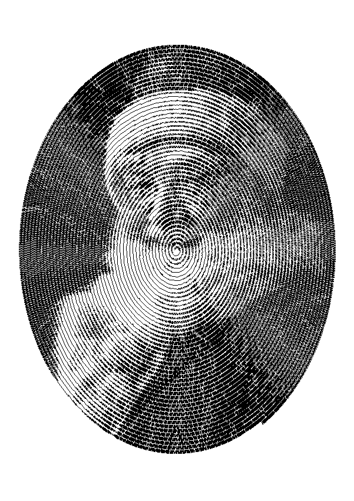 | 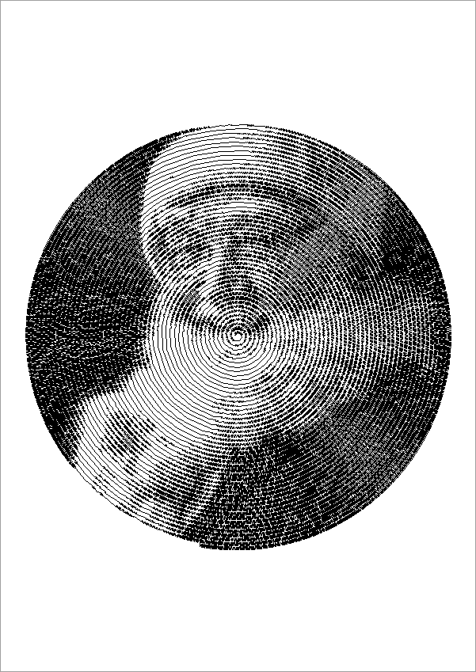 |
| Santa's red hat, white beard and glasses on a dark background. | One continuous sawtooth spiral: tight teeth in dark areas, open rings over the light beard. | The same spiral on the bed, with the plotted page outlined. |

`shape` selects the ring geometry: `circle` (the default) draws true round rings
and can leave a landscape photo's corners empty, `-s shape=cover` grows them
into all four corners, and `-s shape=ellipse` keeps the pre-LUC-203 stretched
look. The gallery image above is the older elliptical render; compare the new
[default circle on the photo](docs/images/luc-176/photo_circle.png),
[`cover` filling its corners](docs/images/luc-176/photo_cover.png),
[`ellipse` old look](docs/images/luc-176/photo_ellipse.png) and
[default circle on Santa](docs/images/luc-176/santa_circle.png). The
[measurements and visual descriptions](docs/TESTING.md#spiral-sawtooth-shapes-circle-ellipse-and-cover-luc-176-2026-11-28)
record how they were rendered.

```bash
penpath convert tests/fixtures/images/reference/santa.jpg -o build/gallery/spiral_sawtooth.svg --paper a4 --max-resolution 800 -s seed=42 -q --pfm spiral_sawtooth:fine
penpath preview build/gallery/spiral_sawtooth.svg -o docs/images/luc-88/spiral_sawtooth_plot.png --px-per-mm 2.86
penpath gcode build/gallery/spiral_sawtooth.svg --profile generic -o build/gallery/spiral_sawtooth.gcode
penpath preview build/gallery/spiral_sawtooth.gcode -o docs/images/luc-88/spiral_sawtooth_gcode.png --px-per-mm 2.86
penpath convert tests/fixtures/images/reference/photo.jpg -o build/gallery/spiral_cover.svg -s seed=42 -s shape=cover --pfm spiral_sawtooth -q
penpath preview build/gallery/spiral_cover.svg -o docs/images/luc-176/photo_cover.png --px-per-mm 3
```

#### `patch_hatch`

| Original | Simulated SVG plot | Simulated G-code |
|:--------:|:------------------:|:----------------:|
|  |  | 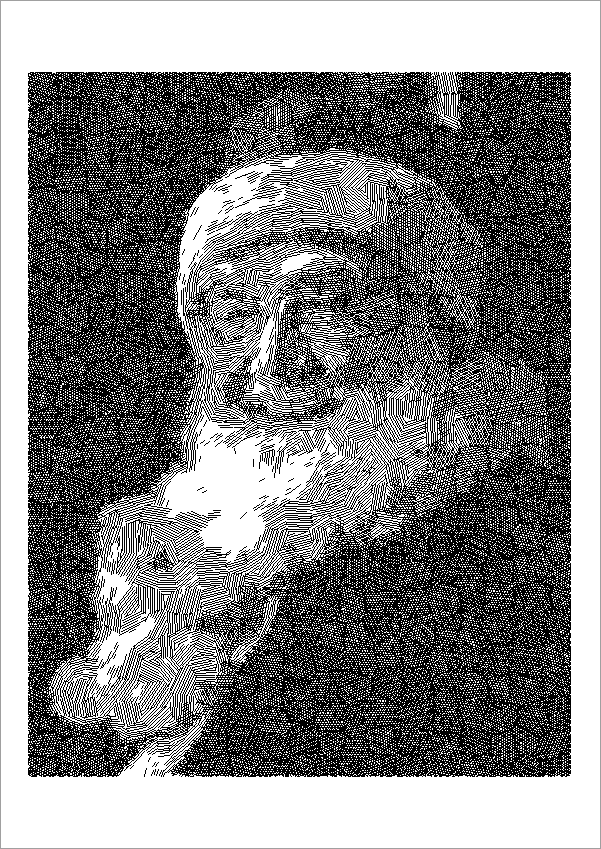 |
| Santa's red hat, white beard and glasses on a dark background. | Small patches of parallel lines, each with its own direction; one layer on the light face and beard, up to four crossing layers in the dark background. | The same patches on the A4 page, with pen-up travel hidden. |

```bash
penpath convert tests/fixtures/images/reference/santa.jpg -o build/gallery/patch_hatch.svg --paper a4 --max-resolution 800 -s seed=42 -q --pfm patch_hatch
penpath preview build/gallery/patch_hatch.svg -o docs/images/patch-hatch/patch_hatch_plot.png --px-per-mm 2.86
penpath gcode build/gallery/patch_hatch.svg --profile generic -o build/gallery/patch_hatch.gcode
penpath preview build/gallery/patch_hatch.gcode -o docs/images/patch-hatch/patch_hatch_gcode.png --px-per-mm 2.86
```

A close-up of the face test image shows the hand-drawn look: each patch has
its own line direction, light areas get one layer and darker ones get more
crossing layers.

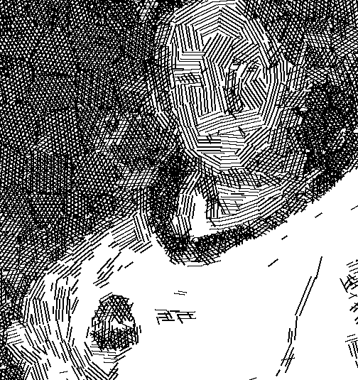

#### `tsp`

| Original | Simulated SVG plot | Simulated G-code |
|:--------:|:------------------:|:----------------:|
|  | 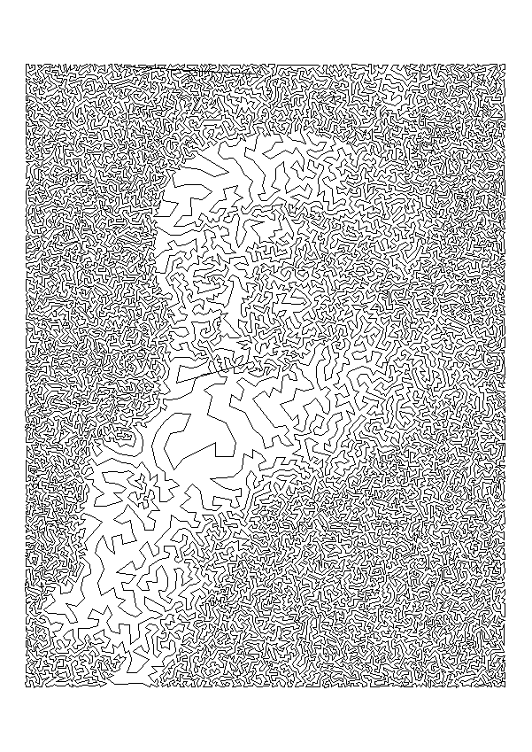 |  |
| Santa's red hat, white beard and glasses on a dark background. | One continuous line: dense meanders in the dark background and coat, open loops over the beard and face. | The same single line on the A4 page: one pen-down, no travel. |

```bash
penpath convert tests/fixtures/images/reference/santa.jpg -o build/gallery/tsp.svg --paper a4 --max-resolution 800 -s seed=42 -q --pfm tsp
penpath preview build/gallery/tsp.svg -o docs/images/tsp/tsp_plot.png --px-per-mm 2.86
penpath gcode build/gallery/tsp.svg --profile generic -o build/gallery/tsp.gcode
penpath preview build/gallery/tsp.gcode -o docs/images/tsp/tsp_gcode.png --px-per-mm 2.86
```

TSP art needs contrast: the [face on A5](docs/images/tsp/face_tsp.png) reads
clearly, while a dark, low-contrast portrait like Santa keeps only its main
light shapes.

#### `squiggle`

| Original | Simulated SVG plot | Simulated G-code |
|:--------:|:------------------:|:----------------:|
|  | 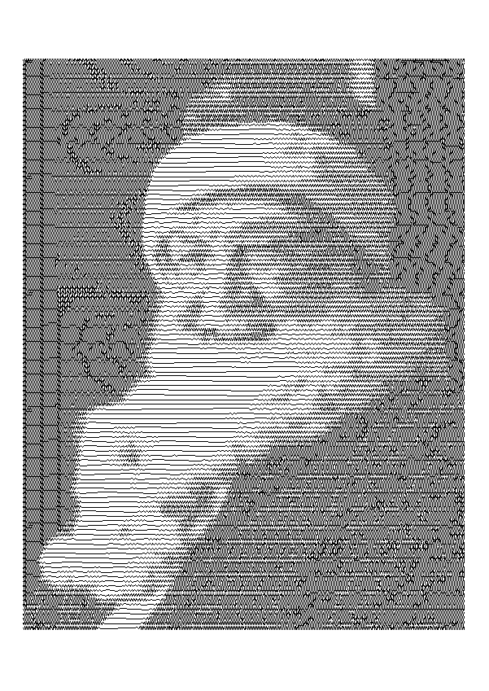 |  |
| Santa's red hat, white beard and glasses on a dark background. | Horizontal rows 2 mm apart: tall, tight waves over the dark background and coat, nearly straight lines over the white beard. | The same rows on the A4 page: one stroke per row. |

```bash
penpath convert tests/fixtures/images/reference/santa.jpg -o build/gallery/squiggle.svg --paper a4 --max-resolution 800 -s seed=42 -q --pfm squiggle
penpath preview build/gallery/squiggle.svg -o docs/images/squiggle/squiggle_plot.png --px-per-mm 2.86
penpath gcode build/gallery/squiggle.svg --profile generic -o build/gallery/squiggle.gcode
penpath preview build/gallery/squiggle.gcode -o docs/images/squiggle/squiggle_gcode.png --px-per-mm 2.86
```

#### `engraving`

| Original | Simulated SVG plot | Simulated G-code |
|:--------:|:------------------:|:----------------:|
|  | 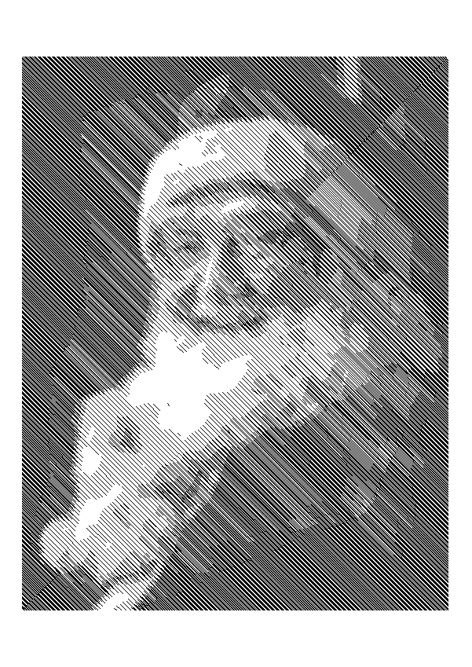 | 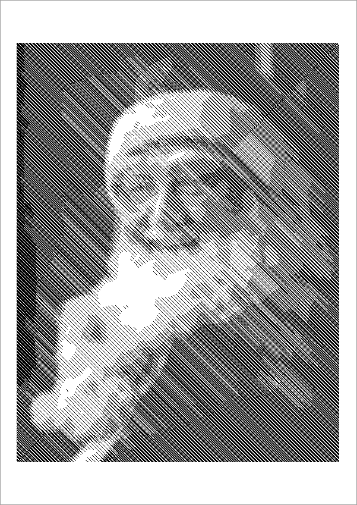 |
| Santa's red hat, white beard and glasses on a dark background. | Copper-plate look: 45° lines 1.5 mm apart that swell to five pen widths in the dark background and thin out over the beard. | The same lines on the A4 page. |

```bash
penpath convert tests/fixtures/images/reference/santa.jpg -o build/gallery/engraving_default.svg --paper a4 --max-resolution 800 -q --pfm engraving:default
penpath preview build/gallery/engraving_default.svg -o docs/images/engraving/santa_default.png --px-per-mm 2.86
penpath gcode build/gallery/engraving_default.svg --profile generic -o build/gallery/engraving.gcode
penpath preview build/gallery/engraving.gcode -o docs/images/engraving/engraving_gcode.png --px-per-mm 2.86
```

The layout presets change how the lines run:
[`engraving:swirl`](docs/images/engraving/santa_swirl.png) twists them around
the centre, and [`engraving:contour`](docs/images/engraving/santa_contour.png)
runs them parallel to the image's main edges. The
[face test image](docs/images/engraving/face_layouts.png) shows all three side
by side (straight, swirl, contour).

### Pen width and colour

On the free [lake photo](tests/fixtures/images/reference/photo.jpg), only the
pen changes between the first three plots: `fine` is 0.3 mm, `medium` 0.5 mm and
`bold` 0.8 mm. The same strokes are drawn with broader marks as the pen widens,
so the hillside and water fill in and the bold plot is nearly solid. These three
previews use `--px-per-mm 3.2` (672×950 px) so the different stroke widths stay visible.

| `fine` (0.3 mm) | `medium` (0.5 mm) | `bold` (0.8 mm) |
|:---------------:|:-----------------:|:---------------:|
| 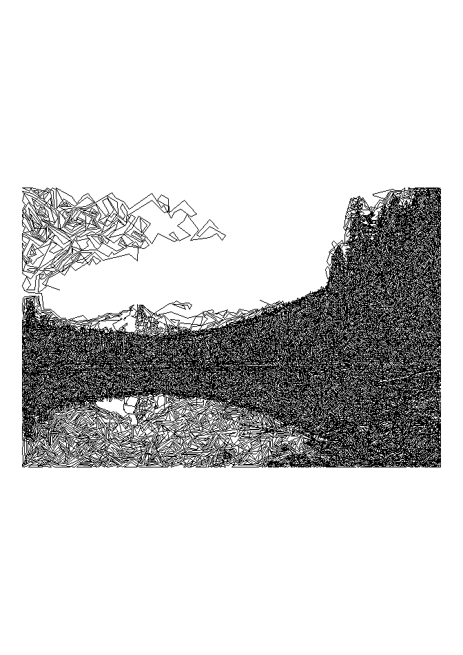 | 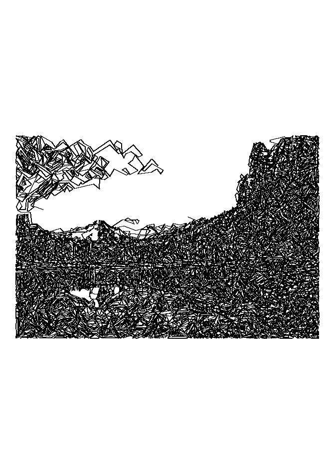 | 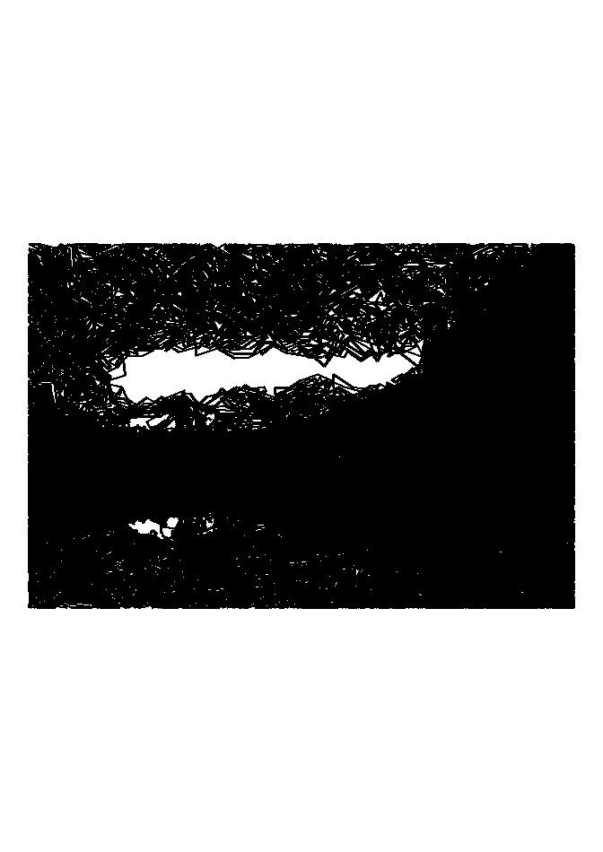 |
| Thin hatching keeps the shoreline and mountain texture separate. | The same strokes overlap more; the dark hillside begins to fill in. | Broad marks merge into solid black over the hill and water. |

The bold plot also goes through the generic profile; its G-code preview shows
the page and the same solid areas the pen will lay down:

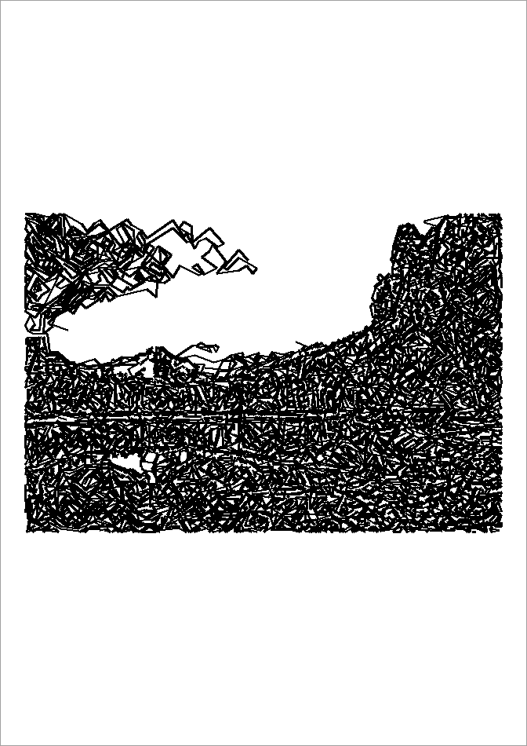

*The 0.8 mm plot inside the A4 page outline, with a single pen and no pen lift drawn.*

```bash
penpath convert tests/fixtures/images/reference/photo.jpg -o build/gallery/pen_fine.svg --paper a4 --max-resolution 800 -s seed=42 -q --pen fine
penpath preview build/gallery/pen_fine.svg -o docs/images/luc-88/pen_fine_plot.png --px-per-mm 3.2
penpath convert tests/fixtures/images/reference/photo.jpg -o build/gallery/pen_medium.svg --paper a4 --max-resolution 800 -s seed=42 -q --pen medium
penpath preview build/gallery/pen_medium.svg -o docs/images/luc-88/pen_medium_plot.png --px-per-mm 3.2
penpath convert tests/fixtures/images/reference/photo.jpg -o build/gallery/pen_bold.svg --paper a4 --max-resolution 800 -s seed=42 -q --pen bold
penpath preview build/gallery/pen_bold.svg -o docs/images/luc-88/pen_bold_plot.png --px-per-mm 3.2
penpath gcode build/gallery/pen_bold.svg --profile generic -o build/gallery/pen_bold.gcode
penpath preview build/gallery/pen_bold.gcode -o docs/images/luc-88/pen_bold_gcode.png --px-per-mm 3.2
```

A pen can also carry its own colour inline. Here the geometry is unchanged and
only the stroke colour becomes red:

| Original | Single-colour plot |
|:--------:|:------------------:|
| 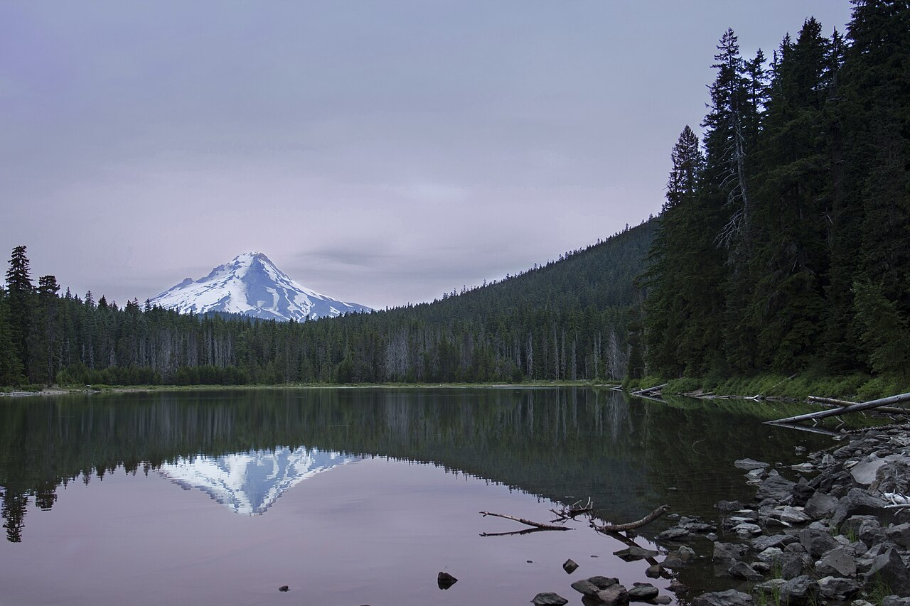 | 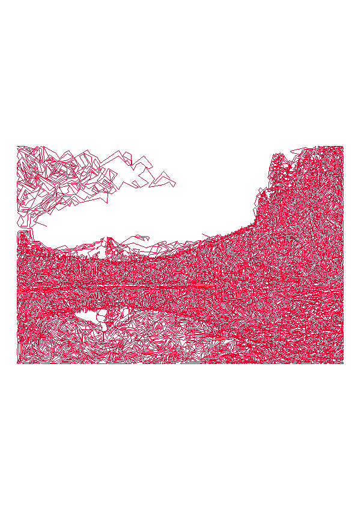 |
| Blue lake, mountains and a bright strip of sky. | The same hatching drawn in `#E4002B`; light sky stays paper. |

```bash
penpath convert tests/fixtures/images/reference/photo.jpg -o build/gallery/pen_colour.svg --paper a4 --max-resolution 800 -s seed=42 -q --pen "0.4,#E4002B"
penpath preview build/gallery/pen_colour.svg -o docs/images/luc-88/pen_colour_plot.png --px-per-mm 2.86
```

### Multi-pen palette

`--palette stabilo_88` splits the free
[Christmas tree photo](tests/fixtures/images/colour/christmas_tree.jpg) into one
layer per used pen (11 here), drawn in palette order. The G-code preview keeps
the colours so you can check which pen goes where before plotting.

| Original | Simulated SVG plot | Simulated G-code |
|:--------:|:------------------:|:----------------:|
| 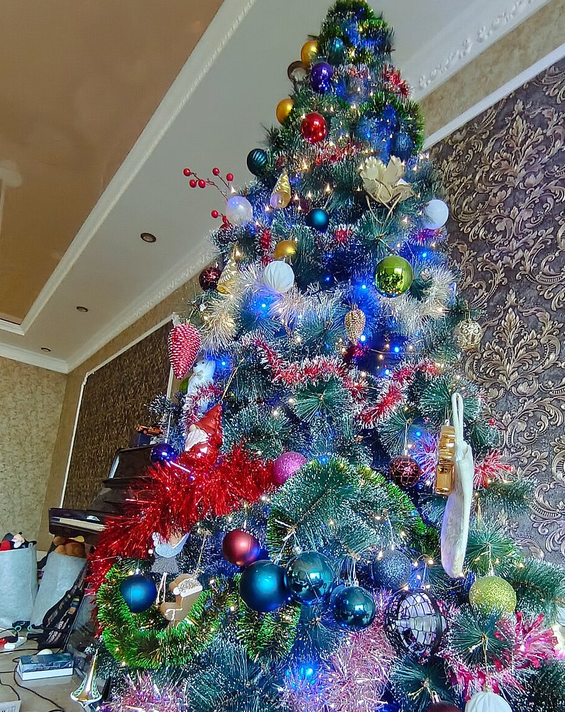 | 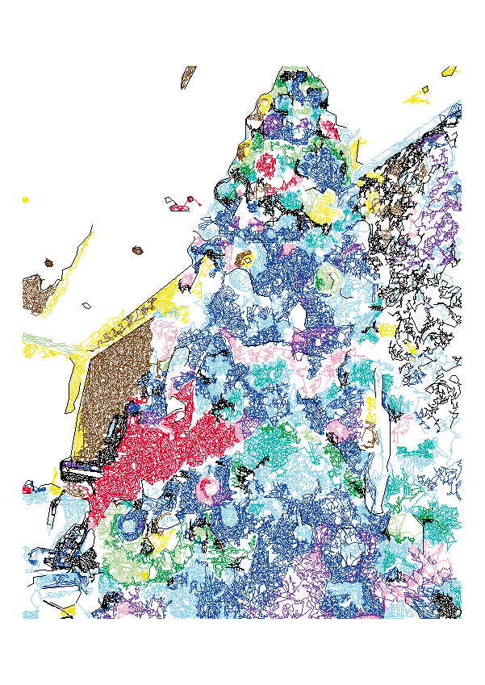 |  |
| Green tree with red baubles, gold decorations and a dark wall. | Blue, red, yellow, green and brown pens separate the foliage and decorations. | The same 11 pen layers on the page, one pen-change block per layer. |

```bash
penpath convert tests/fixtures/images/colour/christmas_tree.jpg -o build/gallery/palette.svg --paper a4 --max-resolution 800 -s seed=42 -q --palette stabilo_88
penpath preview build/gallery/palette.svg -o docs/images/luc-88/palette_plot.png --px-per-mm 2.86
penpath gcode build/gallery/palette.svg --profile generic -o build/gallery/palette.gcode
penpath preview build/gallery/palette.gcode -o docs/images/luc-88/palette_gcode.png --px-per-mm 2.86
```

### Saved looks (styles)

`--style` changes the drawing settings before the PFM runs: `sketch` is the
shipped default, `hatch` narrows the ray band and `outline` adds an edge pass.
SVG plots on the same lake photo are enough to compare them.

| `--style sketch` | `--style hatch` | `--style outline` |
|:----------------:|:---------------:|:-----------------:|
| 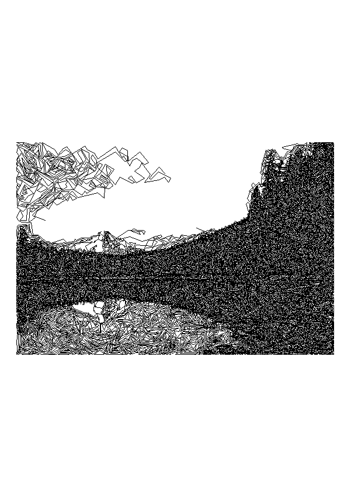 | 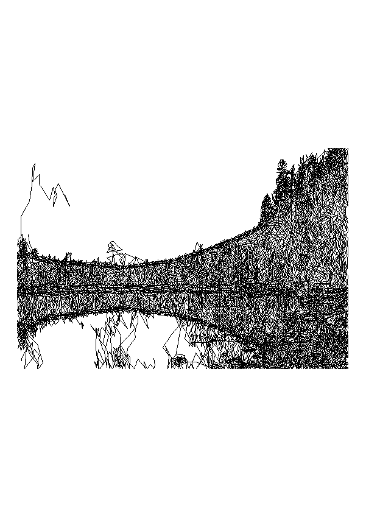 | 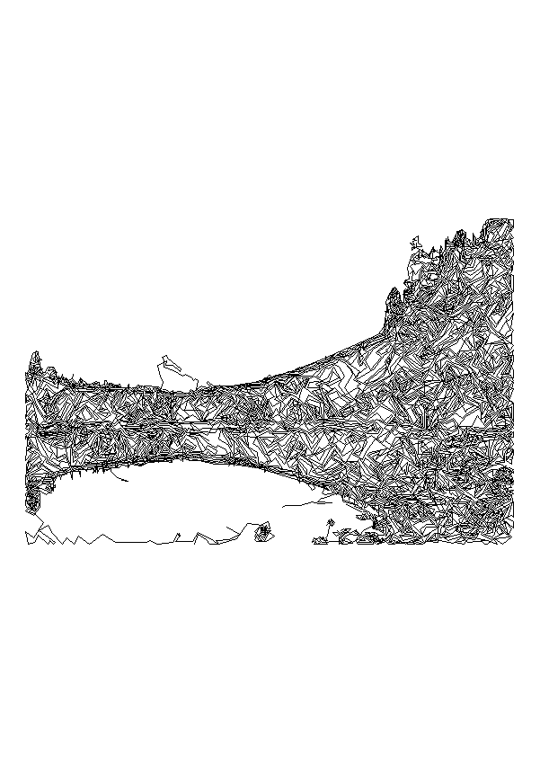 |
| Dense free-angle hatching with solid dark hillside. | Narrower directional strokes follow the slope of the hill. | Open paper with edge lines tracing the shoreline and ridge. |

```bash
penpath convert tests/fixtures/images/reference/photo.jpg -o build/gallery/style_sketch.svg --paper a4 --max-resolution 800 -s seed=42 -q --style sketch
penpath preview build/gallery/style_sketch.svg -o docs/images/luc-88/style_sketch_plot.png --px-per-mm 2.86
penpath convert tests/fixtures/images/reference/photo.jpg -o build/gallery/style_hatch.svg --paper a4 --max-resolution 800 -s seed=42 -q --style hatch
penpath preview build/gallery/style_hatch.svg -o docs/images/luc-88/style_hatch_plot.png --px-per-mm 2.86
penpath convert tests/fixtures/images/reference/photo.jpg -o build/gallery/style_outline.svg --paper a4 --max-resolution 800 -s seed=42 -q --style outline
penpath preview build/gallery/style_outline.svg -o docs/images/luc-88/style_outline_plot.png --px-per-mm 2.86
```

### Reproducible Results

Use `-s seed=N` for deterministic output:

```bash
penpath convert photo.jpg -s seed=42 -o plot1.svg
penpath convert photo.jpg -s seed=42 -o plot2.svg
# plot1.svg and plot2.svg are byte-for-byte identical
```

---

## Built-in Presets

### Pens

| Name | Width (mm) | Colour |
|------|------------|--------|
| `fine` (default) | 0.3 | black |
| `medium` | 0.5 | black |
| `bold` | 0.8 | black |
| `extra_fine` | 0.2 | black |
| `brush` | 1.0 | black |
| `red_fine` | 0.3 | red |
| `blue_fine` | 0.3 | blue |
| `green_fine` | 0.3 | green |

**Inline format:** `WIDTH[,COLOR[,TYPE]]` — width in millimetres, colour as
`#RRGGBB` or a named CSS colour, type one of `ballpoint`, `fineliner`,
`fountain`, `brush`, `marker`, `rollerball`, `gel` (default `rollerball`):

```bash
penpath convert photo.jpg --pen 0.4
penpath convert photo.jpg --pen "0.4,#FF6600"
penpath convert photo.jpg --pen "0.4,#000000,fineliner"
```

### PFM presets

`--pfm` selects one of ten registered algorithms: `sketch_lines` (the default
hatching), `sketch_squares` (grid hatching), `contour` (scikit-image + Shapely
outlines), `stipple` (weighted Poisson-disk dots), `spiral_sawtooth` (one
continuous sawtooth line), `hatch` (straight / cross-hatched lines, optionally
joined into continuous zig-zag strokes with `-s join_runs=true`, which requires
`serpentine=true`), `patch_hatch` (hand-drawn style cross-hatching in small
patches whose lines follow the image's edges), `tsp` (one continuous line
through darkness-weighted dots), `squiggle` (one wavy line per row, waves
taller and tighter where the image is darker) or `engraving` (lines that
swell where the image is darker). Each PFM accepts its own
`-s KEY=VALUE` settings.
`--pfm hatch` is different from `--style hatch`, which is a Sketch Lines look.
Use a qualified `PFM:PRESET` id below; bare names are the legacy Sketch Lines,
Contour and Stipple preset names. `penpath info pfms` is the source of truth: it
lists every PFM, its defaults and its presets.

| PFM | Preset ids | Character |
|-----|------------|-----------|
| `sketch_lines` | `sketch_lines:default`, `sketch_lines:fine`, `sketch_lines:bold`, `sketch_lines:shaded`, `sketch_lines:squiggly`, `sketch_lines:crosshatch`, `sketch_lines:hatch_horizontal`, `sketch_lines:hatch_vertical` | Free-angle hatching. The shipped `default` is calibrated for likeness; `fine` and `bold` change stroke length and density, the rest are directional or shaded looks. |
| `sketch_squares` | `sketch_squares:coarse`, `sketch_squares:fine`, `sketch_squares:crosshatch-grid` | Short grid-aligned strokes: open, dense, or a rotated crosshatch grid. |
| `contour` | `contour_portrait`, `contour_silhouette` | Four threshold levels for internal detail on a face; one level and a larger minimum speck size for a few bold outlines. |
| `stipple` | `stipple_default`, `stipple_fine`, `stipple_bold` | 1–3 px dots for balanced tone and cost; finer denser texture, or fewer coarser marks. `-s dot_shape=circle\|tap` switches dots from the default `dash` to closed rings or in-place pen taps. |
| `spiral_sawtooth` | `spiral_sawtooth:fine`, `spiral_sawtooth:bold`, `spiral_sawtooth:parabolic` | One continuous line with round rings by default (`-s shape=circle`); `-s shape=cover` grows them into all four corners, and `-s shape=ellipse` keeps the old stretched look. Presets: tight rings for fine detail, wide teeth for bold, or two opposed parabolic branches. |
| `patch_hatch` | `patch_hatch:default`, `patch_hatch:fine`, `patch_hatch:bold`, `patch_hatch:fast` | Hand-drawn cross-hatching in 4–10 mm patches, each with its own direction along the local edges; darker tones add crossing layers. `fine` and `bold` change spacing and patch size; `fast` joins every patch into zig-zag strokes (about 2x fewer pen lifts, with visible patch borders). |
| `squiggle` | `squiggle:default`, `squiggle:fine`, `squiggle:diagonal` | One wavy stroke per row: 2 mm horizontal rows for `default`, 1.2 mm rows with tighter waves for `fine`, 45° rows for `diagonal`. Very few pen lifts. |
| `engraving` | `engraving:default`, `engraving:fine`, `engraving:swirl`, `engraving:contour` | Lines whose width follows darkness, drawn as up to N strokes one pen width apart: 1.5 mm straight 45° lines for `default`, 0.9 mm for `fine`, lines twisted around the centre for `swirl`, or parallel to the main edges for `contour`. |
| `tsp` | `tsp:default`, `tsp:fine` | One continuous line through dots placed by darkness: about 0.8 mm apart in black areas for `default`, 0.55 mm for `fine` (more detail, longer plot). One pen lift. |
| `hatch` | `hatch:default`, `hatch:crosshatch`, `hatch:fine`, `hatch:single` | Straight parallel lines: two joined directions for `default` (`min_gap=0.5`, `join_runs=true`), four unjoined directions for `crosshatch`, 0.6 mm spacing for `fine`, or progressively tighter same-direction bands for `single`. |

Simulated plot previews on the free Santa portrait:
[sketch_squares:fine](docs/images/luc-88/sketch_squares_plot.png) ·
[contour_portrait](docs/images/luc-139/contour_portrait.png) ·
[contour_silhouette](docs/images/luc-139/contour_silhouette.png) ·
[stipple_default](docs/images/luc-140/stipple_default.png) ·
[stipple_fine](docs/images/luc-140/stipple_fine.png) ·
[stipple_bold](docs/images/luc-140/stipple_bold.png) ·
[spiral_sawtooth circle](docs/images/luc-176/santa_circle.png) ·
[hatch:default on the photo](docs/images/luc-167/photo_hatch_default.png) ·
[hatch:crosshatch on the face](docs/images/luc-167/face_hatch_crosshatch.png) ·
[patch_hatch on the face](docs/images/patch-hatch/face_patch_hatch.png) ·
[patch_hatch on the photo](docs/images/patch-hatch/photo_patch_hatch.png) ·
[tsp on the face](docs/images/tsp/face_tsp.png) ·
[tsp on the photo](docs/images/tsp/photo_tsp.png) ·
[squiggle on the face](docs/images/squiggle/face_squiggle.png) ·
[squiggle on the photo](docs/images/squiggle/photo_squiggle.png).
The
[Sketch Squares gate](docs/TESTING.md#sketch-squares-readability-and-plot-cost-gate-luc-149-2026-11-27),
[Contour gate](docs/TESTING.md#contour-readability-and-plot-cost-gate-luc-146-2026-11-27),
[Stipple gate](docs/TESTING.md#stipple-likeness-and-plot-cost-gate-luc-154-2026-11-27)
[Hatch gate](docs/TESTING.md#hatch-acceptance-gate-luc-167-2026-11-27)
and [Patch Hatch measurements](docs/TESTING.md#patch-hatch-measurements-2026-11-27)
record the measured readability and plot cost; acceptance is by looking at the
previews, not by SSIM alone.

```bash
penpath convert photo.jpg --pfm sketch_lines:fine -o fine.svg
penpath convert photo.jpg --pfm sketch_squares:crosshatch-grid -o grid.svg
penpath convert photo.jpg --pfm contour -o outlines.svg
penpath convert photo.jpg --pfm contour_portrait -o portrait_contour.svg
penpath convert photo.jpg --pfm stipple_fine --no-vpype -s seed=42 -o dots.svg
penpath convert photo.jpg --pfm stipple -s dot_shape=circle -s seed=42 -o circles.svg
penpath preview dots.svg -o dots.png --px-per-mm 4
penpath convert photo.jpg --pfm spiral_sawtooth:bold -s seed=42 -o spiral.svg
penpath convert photo.jpg --pfm hatch:crosshatch -o hatch.svg
penpath convert photo.jpg --pfm patch_hatch:fine -s seed=42 -o patches.svg
penpath convert photo.jpg --pfm tsp:fine -s seed=42 -o one_line.svg
penpath convert photo.jpg --pfm squiggle:diagonal -o waves.svg
penpath convert photo.jpg --pfm engraving:contour -o engraved.svg
# Every PFM and preset side by side; stdout stays empty
penpath compare photo.jpg -o compare.png --dpi 2 --max-resolution 64
```

The [contact sheet](docs/images/luc-141/contact_sheet.png) below shows the
catalog on the Santa portrait, including the four Spiral tiles; the labels name
each PFM and preset, and a failing tile would show its error instead of ink.

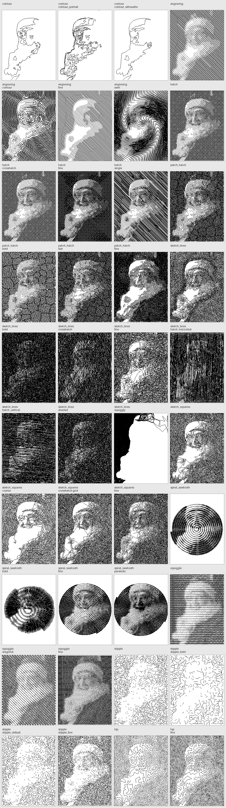

### Palettes: one SVG layer per pen

Each pixel is assigned to the palette pen whose colour is nearest in CIE Lab,
and that pen receives a full-size greyscale image holding the luminance of its
own pixels and white elsewhere. Paper-coloured pixels are masked to white
before separation, so the lightest pen cannot scribble over the page; use
`--no-background` if you want the old behaviour. Filters, the selected PFM and geometry
optimization then run once per pen, so lines from different pens are never
sorted together. Every pen that draws becomes one Inkscape layer, named after
the pen, in drawing order — light ink first, dark ink later and a near-black pen
last. A final black key layer traces the image's edges on top of the colours by
default in palette mode. Palette order only assigns colours and breaks ties
between equally light pens:

```bash
# Photo -> SVG with one layer per used pen (the Christmas-card workflow)
penpath convert photo.jpg -o card.svg --palette stabilo_88 -s seed=42

# The black key edge layer is on in palette mode; turn it off if you want only colours
penpath convert photo.jpg -o card_key.svg --palette stabilo_88 -s seed=42 --key-layer
penpath convert photo.jpg -o card_no_key.svg --palette stabilo_88 -s seed=42 --no-key-layer

# See the pens, colours and drawing order
penpath info palettes
penpath info palettes --format json

# See which pens the colour separation picks and each pen's pixel share
penpath info palette-match photo.jpg
penpath info palette-match photo.jpg --palette stabilo_88 --format json
penpath info palette-match photo.jpg --palette "red=0.4,#FF0000;blue=0.4,#0000FF"

# Check the result before plotting
penpath preview card.svg -o card.png --px-per-mm 10
penpath evaluate photo.jpg card.svg
```

`penpath info palette-match` reports one row per palette pen (including unused
pens) and an unassigned share. It measures the raw separation on the loaded
image: no filters, background masking or saturation boost, and pixels in regions
smaller than 8 px count as unassigned. Percentages are of all image pixels, not
of the finished drawing.

A project file can use `palette: stabilo_88` or an explicit ordered `pens:` list
instead of `pen:`. Pens draw light → dark with a near-black pen last, and the
SVG layers follow that order; the palette's own order only assigns colours and
breaks ties. An unused pen gets no layer, so a twelve-pen palette may yield
fewer than twelve layers. Without `--palette`, the single default pen draws the
whole image and produces one layer, exactly as before, unless `--key-layer` is
given, which appends the black edge layer as the last layer. `--pen` and
`--palette` are mutually exclusive.

The built-in `stabilo_88` palette in drawing order (all 0.4 mm), also reported
by `penpath info palettes`:

| # | Layer label | Colour |
|--:|-------------|--------|
| 1 | `stabilo_88_yellow` | `#F7E300` |
| 2 | `stabilo_88_light_blue` | `#8CCFE8` |
| 3 | `stabilo_88_light_green` | `#A9D18E` |
| 4 | `stabilo_88_pink` | `#F2A0BE` |
| 5 | `stabilo_88_cyan` | `#00B5B0` |
| 6 | `stabilo_88_orange` | `#F4741F` |
| 7 | `stabilo_88_green` | `#00963E` |
| 8 | `stabilo_88_red` | `#E4002B` |
| 9 | `stabilo_88_brown` | `#7A4B23` |
| 10 | `stabilo_88_purple` | `#6C3B9E` |
| 11 | `stabilo_88_blue` | `#1B4C9E` |
| 12 | `stabilo_88_black` | `#000000` |

### SVG layout and `vpype read`

Every SVG penpath writes uses millimetres: for A4 the root is
`width="210mm" height="297mm" viewBox="0 0 210 297"`, and each used pen gets one
Inkscape layer with `id="layerN"` (N in drawing order) and the pen name as
`inkscape:label`. Strokes have `fill="none"`, a hex `stroke` and a millimetre
`stroke-width`. No background shape is written: paper colour is a
`preview`/`evaluate` option (`--paper-color`, default `#FFFFFF`), not ink.

Do not feed a penpath SVG back to `vpype read`. vpype takes the layer number
from the digits in `inkscape:label`, so `stabilo_88_red` and
`stabilo_88_green` both read as layer 88 and merge. Read the file with an XML
parser and use the `<g>` groups with their numeric `layerN` ids instead; the
G-code step does this.

### Papers

| Name | Size (mm) | Margins (mm) |
|------|-----------|--------------|
| `a4` | 210 × 297 | 10 all sides |
| `a4_landscape` | 297 × 210 | 10 all sides |
| `a3` | 297 × 420 | 15 all sides |
| `a3_landscape` | 420 × 297 | 15 all sides |
| `letter` | 216 × 279 | 10 all sides |
| `letter_landscape` | 279 × 216 | 10 all sides |
| `square_200` | 200 × 200 | 10 all sides |
| `postcard` | 148 × 105 | 5 all sides |

**Inline format:** `WIDTHxHEIGHT[,MARGINS]` — one margin for all sides
(`210x297,10`) or four in **top,right,bottom,left** order
(`300x200,15,10,15,10`).

By default (`--fit fit`) the image is contained in the drawable area — the
paper minus its margins — keeping its aspect ratio. `--fit fill` covers that
area and crops the overflow; `--fit none` draws at the image's pixel size at
`--dpi` (default 300). `--dpi` changes the drawn size **only** with
`--fit none`: fit and fill scale the image to the paper. `--margin MM` overrides
the paper margins for one run (one value or four in top,right,bottom,left order),
including for a paper from `--project`; a margin that leaves no drawable area is
rejected. On `190x190` the default 10 mm margin leaves a 170 × 170 mm drawing.

### Filters (applied in order)

| Name | Parameters | Description |
|------|------------|-------------|
| `grayscale` | `method=luminance\|lightness\|average\|red\|green\|blue` | Convert to single channel |
| `threshold` | `level=0-255`, `dither=none\|floyd_steinberg\|ordered` | Binarize (2 levels) |
| `posterize` | `levels=2-256`, `dither=none\|floyd_steinberg\|ordered` | Reduce to N tonal levels |
| `gaussian_blur` | `radius=float>=0` | Gaussian blur |
| `box_blur` | `radius=int>=0` | Box blur |
| `contrast` | `factor=float>=0` | Contrast adjustment (1.0 = no change) |
| `brightness` | `factor=float>=0` | Brightness adjustment (1.0 = no change) |
| `gamma` | `gamma=float>0` | Gamma correction (1.0 = no change) |
| `invert` | (none) | Invert colors (negative) |

---

## Configuration

User config at `~/.config/penpath/config.toml`:

```toml
# penpath user config
default_paper = "a4"
default_pen = "fine"
default_pfm = "sketch_lines"
vpype_path = "vpype"
output_dir = "."
log_level = "INFO"
```

Manage with:

```bash
penpath config show      # View current config
penpath config init      # Create default config
penpath config edit      # Open in $EDITOR
```

### Machine profiles

Machine profiles hold bed, feed and pen values for a plotter. Two built-ins
ship: `generic` (a plain Z-lifted plotter) and `aquila` (the Voxelab Aquila with
a pen offset, a ramped landing and a touch-spot pen change; its machine numbers
come from sergio's `aquila-gcode-reference` script, plus penpath's own 10 mm
safety margin). The Aquila profile pauses for each pen with `M0`; never use
`M25` to pause on this firmware. List the built-ins
and your own machines with `penpath info profiles`, which shows each machine's
safety margin; `penpath gcode --margin MM` overrides that margin for one run.
The file format and an example are in
[docs/CLI.md](docs/CLI.md#machine-profile-format).

For the full image → SVG → reviewed preview → G-code → SD card → plot operator
path on the Aquila, including the machine checklist and the equivalence check
against sergio's reference script, see [docs/AQUILA.md](docs/AQUILA.md). A small
runnable version is in [`examples/aquila/`](examples/aquila/).

---

## How It Works

```
Input Image
    │
    ▼
┌─────────────────────────────────────┐
│  Filter Pipeline (user-defined)     │
│  grayscale → threshold → blur → ... │
└─────────────────────────────────────┘
    │
    ▼
┌─────────────────────────────────────┐
│  PFM: Sketch Lines / Squares (DBV3) │
│  • Random-angle or grid-angle search│
│  • Darkest-pixel sampling           │
│  • Tonal shading branch             │
│  • Squiggle/erase variation         │
└─────────────────────────────────────┘
    │
    ▼
┌─────────────────────────────────────┐
│  Geometry Optimization              │
│  1. Simplify (RDP, tolerance)       │
│  2. Merge (linemerge + collinear)   │
│  3. Sort (greedy NN + 2-opt)        │
└─────────────────────────────────────┘
    │
    ▼
┌─────────────────────────────────────┐
│  vpype Pipeline (optional)          │
│  linemerge → linesimplify → reloop  │
│  → linesort (geometry only)         │
└─────────────────────────────────────┘
     │
     ▼
Output SVG (mm, one layer per used pen, written by penpath)

```

---

## Requirements

- Python ≥ 3.14
- `vpype` (optional, for best output) — `pip install "penpath[vpype]"`
- System dependencies for `shapely` (GEOS) — usually via wheels

---

## License

MIT — see [LICENSE](LICENSE).

---

## Links

- **Documentation**: [docs/CLI.md](docs/CLI.md)
- **Technical Plan**: [docs/PLAN.md](docs/PLAN.md)
- **Conventions**: [docs/CONVENTIONS.md](docs/CONVENTIONS.md)
- **Testing**: [docs/TESTING.md](docs/TESTING.md)
- **Issues**: [GitHub Issues](https://github.com/sermelo/penpath/issues)
- **Changelog**: [CHANGELOG.md](CHANGELOG.md) (if exists)